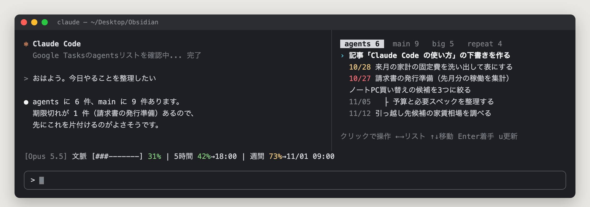
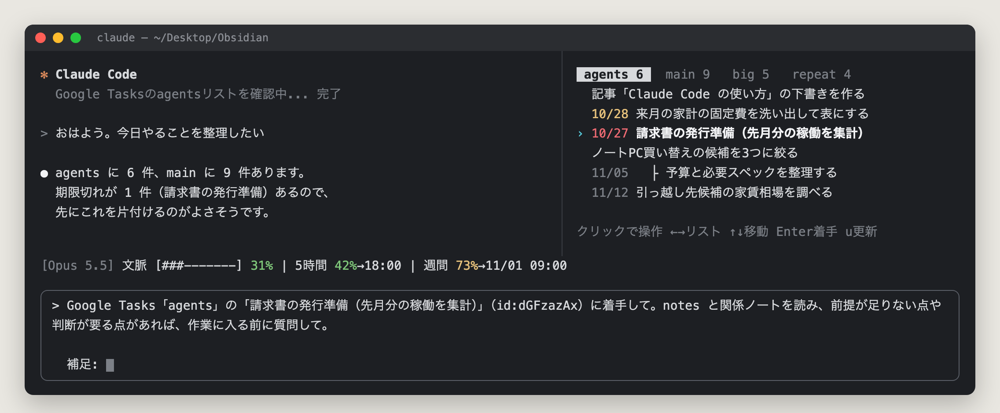
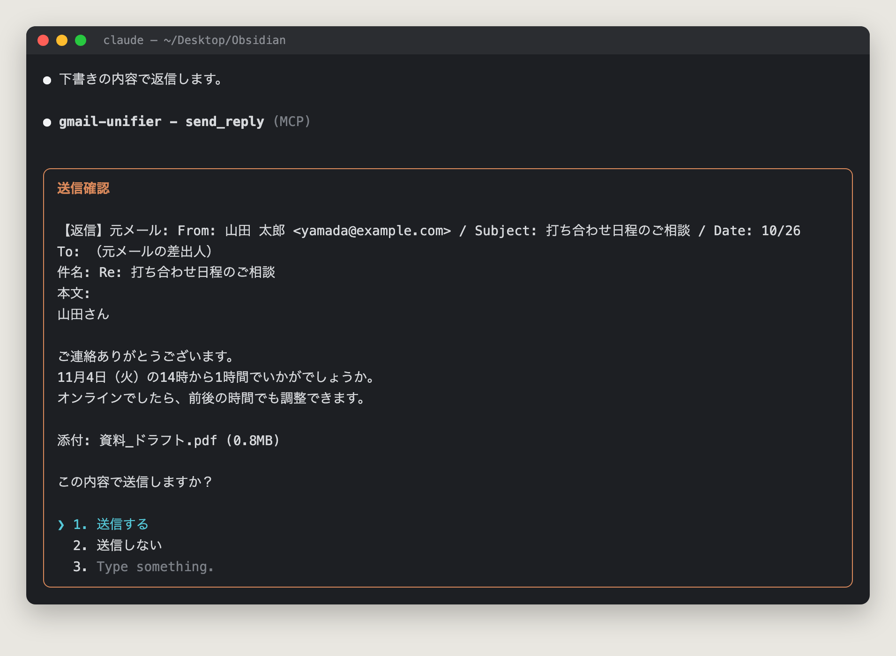
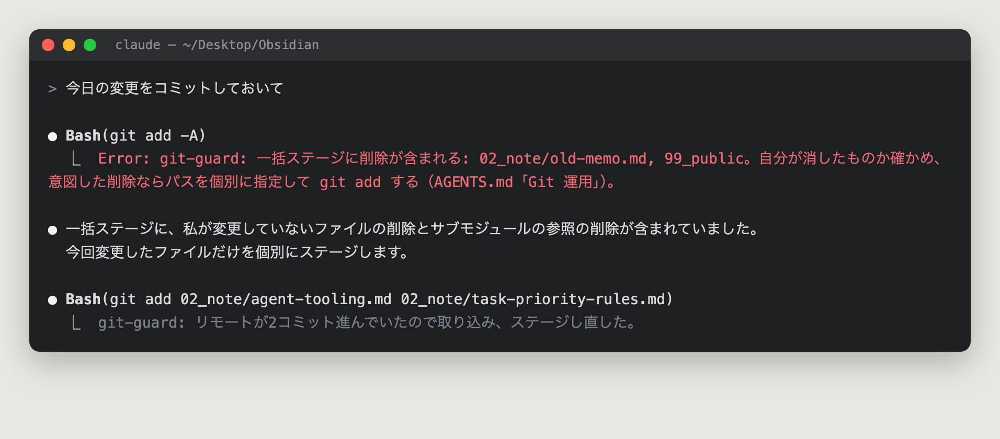
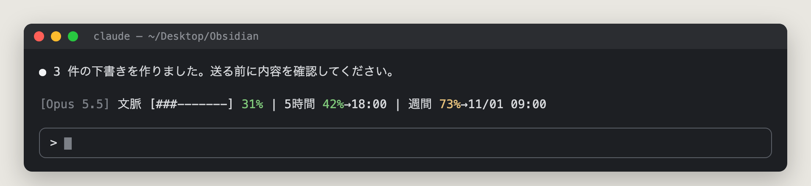
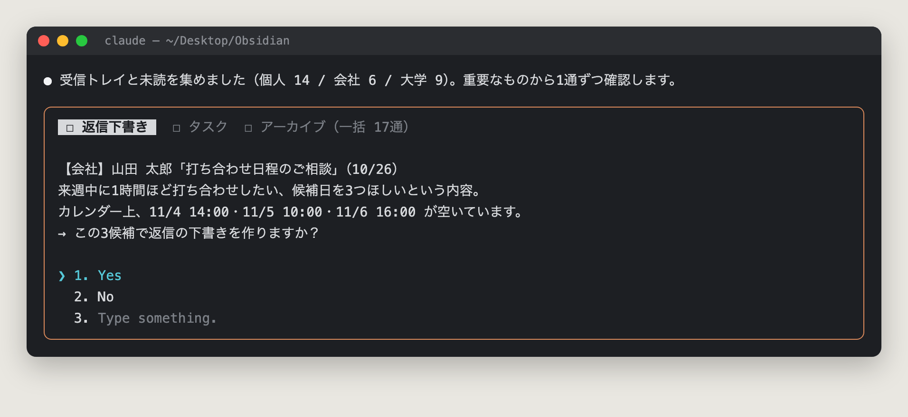

## はじめに

この半年ほど、**「やること」の入口をすべて Google Tasks に集め、Claude Code にそれを片付けてもらう**という使い方をしている。

コードを書かせるだけではない。メールの仕分け、請求書の発行、タスクの並び替え、調べもの、書類の下書き——生活と仕事の細かい用事の大半が、ターミナルの Claude Code から流れていく。

効果は数字にはっきり出た。Google Tasks で完了したタスクの数（月別）はこうなった。

| 月 | 2026-01 | 03 | 05 | 07 | 08 | **09** | **10（20日まで）** |
| --- | --- | --- | --- | --- | --- | --- | --- |
| 完了数 | 49 | 49 | 51 | 92 | 80 | **233** | **302** |

9月から一気に3倍以上になっている。この月に、この記事で紹介する仕組み（AI に任せるタスク専用のリスト、自作 MCP、mod）がそろった。

この記事では、その仕組みを3つの部品に分けて紹介する。

1. **Google Tasks を起点にした日常タスクの回し方**
2. **自作 MCP** — AI が外部サービスを直接触るための道具
3. **mod** — Claude Code の画面と挙動そのものを改造するプラグイン

最後に、どれにも共通する「AI に任せるときの型」をまとめる。

> 記事中の画面の画像は、実際の画面にはタスク名やメールの中身が映るため、**ダミーのデータで再現したもの**。表示される文言・色・配置は、mod のソースに合わせてある。

---

## 全体の形

部品は3つの役割に分かれている。

```text
┌──────────────┐   今やること    ┌──────────────────┐   長く残すこと   ┌──────────────┐
│ Google Tasks │ ─────────────▶ │   Claude Code    │ ──────────────▶ │ Obsidian 保管庫 │
│  （今の正解） │ ◀───────────── │（手。MCP・mod・   │ ◀────────────── │（記憶・判断の記録）│
└──────────────┘  完了・新タスク │  スキルを持つ）   │  前提・ルールを読む └──────────────┘
                                 └──────────────────┘
                                   │ MCP で直接触る
                                   ▼
                    Gmail ×3 / Calendar / Drive / 会計 / 請求書 / Slack …
```

- **Google Tasks** は「今どうなっているか」の正。スマホからも見られる。
- **Obsidian の保管庫**は「なぜそうしたか」の記憶。判断の経緯や、AI が従うルールを置く。保管庫の作り方は以前 [Hugo × Obsidian × GitHub Pages の記事](/pages/how-to-build-my-publish-system/) に書いた。
- **Claude Code** はその間に立つ手。保管庫を作業ディレクトリにして起動し、MCP で外のサービスを触る。

ポイントは、**タスクの状態を保管庫に書かない**こと。以前はノートに `- [ ]` を書いていたが、AI がノートを読むたびに古いチェックボックスまで読み込み、どれが今の話か分からなくなった。今は「実行タスクは Google Tasks、保管庫には判断の記録だけ」と分けている。

---

## 1. Google Tasks を起点にする

### リストは「AI に投げれば済むか」で分ける

リストはこう分けている。

| リスト | 入れるもの |
| --- | --- |
| **`agents`** | **AI に依頼すれば済むもの。** 調査・下調べ・見積もり・文書作成など、本人の判断や実行そのものを必要としないもの |
| `main` | 本人が動く必要がある、すぐ片付く粒度のもの |
| `big` | 本人が動く必要があり、規模が大きい・期限がない・ざっくりしているもの |
| `repeat` | 繰り返し発生するもの |

一番効いたのが **`agents` リスト**だ。会話の途中で「これは今やらないけど、AI に頼めば済むな」と思ったら、その場で Claude に `agents` へ積ませる。あとで別のセッションの Claude が拾って片付ける。

**自分の頭から「あれもやらなきゃ」が消える**のが大きい。積んだ時点で、半分は終わったようなものになる。

### セッション開始時に、`agents` を自動で読ませる

Claude Code の設定フックには、セッション開始時に MCP のツールを直接呼ぶ `mcp_tool` という種類がある。これで `agents` リストの中身を毎回コンテキストに流し込んでいる。

```json
{
  "hooks": {
    "SessionStart": [
      {
        "hooks": [
          {
            "type": "mcp_tool",
            "server": "gtasks",
            "tool": "list_with_tree",
            "input": { "taskListId": "<agents リストの ID>" },
            "timeout": 15,
            "statusMessage": "Google Tasksのagentsリストを確認中..."
          }
        ]
      }
    ]
  }
}
```

起動した Claude は、何も言わなくても「今 AI 向けに積まれている仕事」を知っている。「agents の上から片付けて」と言えば、それで始まる。

### notes に「次の AI が調べ直さなくて済む情報」を書く

`agents` のタスクを拾うのは、会話の文脈を知らない**新しいセッションの AI** だ。だから、タスクの notes 欄にはこういう形で前提を残させている。

```text
目的: 〜するため（1行）
手順:
1. …
2. …
前提: 関係ノート 02_note/xxx.md / 使うアカウント / 確定済みの数値
止める条件: 〜の判断が要ったら本人に確認
```

特に大事なのが **「止める条件」**。AI に任せきりにすると、本人が決めるべきところまで勝手に決めてしまう。どこで手を止めて聞くかを、タスクを作る時点で決めておく。

背景や判断の理由のような「あとでも使う知識」は notes に書かず、保管庫のノートに書いてパスだけ置く。notes はタスクと一緒に消えてよい使い捨ての情報、という扱いだ。

### `/todo` — タスクを横に出して、Enter で着手

ここからが mod の出番になる（mod 自体の説明は後の章でする）。

自作 mod `tasks-pane` は、Google Tasks の各リストを Claude Code の横のパネルに常に出しておく。



- ←→ でリスト、↑↓ でタスクを選ぶ
- 期限が3日以内のものは黄色、期限切れは赤
- 10分ごとと、Claude がタスクを更新したときに取り直す

そして **Enter を押すと、そのタスクに着手する依頼文が入力欄に入る。**



入る文はリストによって変えている。

- `agents` のタスク → 「notes と関係ノートを読んで、着手して」
- それ以外（自分が動くタスク） → 「これは私が動くタスクなので、AI が先に下調べ・準備できることを提案して」

どちらにも「前提が足りない点や判断が要る点があれば、作業に入る前に質問して」と付く。**送信はせず、入力欄に入れるだけ**にしてあるので、末尾の「補足:」に一言足してから Enter で送れる。

自分が動くタスクでも AI に投げているのがミソで、たとえば「役所に書類を出す」なら、必要書類の洗い出し、窓口の受付時間、記入例の下書きまでは AI が先にやってくれる。自分は最後の「行って出す」だけになる。

### 並び替えも AI に任せる — `/prioritize`

タスクが増えると、どれからやるかを決めること自体が負担になる。そこで、並び替えをスキル（`/prioritize`）にした。

基準は保管庫のノートに書いてあり、上から順に効く。

1. **依存関係** — A の結果がないと B が決まらないなら A が上
2. **取り逃がし** — 締切を過ぎると権利がなくなるもの
3. **締切の近さ**
4. **金額・影響の大きさ**
5. **手間の小ささ** — 同程度ならすぐ終わるものを上に

**並び替えは聞かずに実行し、リストをまたぐ移動と完了だけは Yes/No で確認を取る**ようにしている。最初は並び替えも毎回確認していたが、一度も No と言わなかったので確認をやめた。

---

## 2. 自作 MCP — 「届く手段」を自分で作る

### ブラウザでもできるが、MCP を選ぶ

Claude Code はブラウザ操作（Claude in Chrome）もできるので、Web でできることならたいてい AI から触れる。それでも、**MCP で届くものは必ず MCP を使う**と決めている。

理由は文脈の消費量だ。ブラウザ操作は画面を読むので、スクリーンショット1枚が重い。数回の操作で、MCP を数十回呼ぶのと同じくらいの文脈を使ってしまう。MCP はテキストで返るので、1桁も2桁も軽い。

**「ブラウザでもできる」は、ブラウザを使う理由にならない。** 既製の MCP が無い、あるいは足りないなら、自分で作る。そうして作ったのが次の3つだ。

| MCP | 何ができるか |
| --- | --- |
| **`gmail-unifier`** | 個人・会社・大学の3つの Gmail を、転送せずに直接横断する。検索・閲覧・下書き・送信・返信・転送・ラベル・ゴミ箱まで |
| **`gtasks`**（改造版） | Google Tasks API の全操作。既存の MCP に、取得・リスト作成・位置指定などを足した |
| **`mf-invoice`** | マネーフォワード クラウド請求書の API を包んだもの。請求書・見積書・取引先の操作 |

### `gmail-unifier` — 3つのメールボックスを、1つの MCP で

メールアドレスが3つあると、「あのメールどこに来たっけ」が毎回起きる。転送でまとめる手もあるが、返信の送信元がずれたり、アーカイブ済みのメールが探せなかったりする。

そこで、**各アカウントを個別に OAuth で認可し、それぞれの正本を直接検索する** MCP を作った。設計で気をつけたのは、AI が間違えにくい形にすることだ。

**① 操作対象は「署名付きハンドル」でしか指定できない**

検索結果の各メールには、どのメールボックスのものかを焼き込んで署名した「ハンドル」が付く。返信や削除はこのハンドルでしか指定できない。AI がメール ID を取り違えたり、別のアカウントの ID を渡したりしても、署名が合わないので通らない。

**② 返信・転送は、受け取ったアカウントから送られる**

返信のときは送信元（`from`）を指定できない。会社宛てのメールに個人アドレスから返す、という事故が構造的に起きない。

**③ 完全削除のツールを作らない**

削除はゴミ箱への移動だけ。認可の範囲は全権限にしてあるが、ツールとして存在しなければ AI は呼べない。**AI に渡す道具は、「できること」より「できないこと」を先に決める**と安心して任せられる。

### `gtasks` — 既存の MCP を手元で改造する

Google Tasks の MCP は公開されているものがあったが、取得や位置の指定（並び替えに必要）が無かった。そこでフォークして足し、ついでに出力を短くした。毎回のセッション開始時に流し込むので、出力が短いほど文脈が節約できる。

### MCP を作るときに決めていること

- **秘密の値は保管庫・Git・チャットに置かない。** トークンは macOS の Keychain に置く
- **独立したリポジトリにして、保管庫の外（`~/Documents/<名前>/`）に置く。** 保管庫には判断の記録と参照だけを残す
- **テストで、既製の MCP と機能の抜けがないかを確かめる。** `gmail-unifier` は、Claude 標準の Gmail コネクタの全30ツールとの対応表をテストに持たせている

---

## 3. mod — Claude Code そのものを改造する

### mod とは

**mod** は、Claude Code の内部イベントに TypeScript で処理を差し込めるプラグインだ（2026年10月時点では早期アクセスの機能）。

設定ファイルの `hooks` が「外部コマンドを呼ぶ」だけなのに対して、mod は Claude Code の中で動くので、次のようなことができる。

- 横のパネル、入力欄の上の帯、ボタン付きの確認ダイアログを出す
- ツールの呼び出しを止める・書き換える・承認する
- モデルを介さずに MCP を直接呼ぶ
- セッション中の状態を覚えておく

さっきの `tasks-pane` も mod だ。ほかに4つ作って使っている。

| mod | 何をするか |
| --- | --- |
| `tasks-pane` | Google Tasks を横のパネルに出す（前の章） |
| **`send-confirm`** | メール送信の直前に、宛先・件名・本文・添付を見せる確認画面を出す |
| **`git-guard`** | `git add` / `commit` の前に最新を取り込む。削除を巻き込む一括ステージや force push を止める |
| `vault-guard` | 公開用のフォルダに、非公開ノートへの参照を書こうとしたら止める |
| `status-band` | 入力欄の上に、モデル・文脈の使用率・利用枠を1行で出す |

### `send-confirm` — 「送っていい？」をチャットからダイアログへ

AI にメールを送らせるとき、怖いのは誤送信だ。以前は「送信前に、宛先・件名・本文をチャットに出して許可を取って」と指示していた。ただこれだと、

- AI がチャットに出した内容と、実際にツールに渡す引数が一致している保証がない
- 毎回「送っていいですか？」「はい」の往復が要る

という問題があった。

`send-confirm` は、**送信ツールが実際に呼ばれる瞬間**に割り込んで、その引数そのものをダイアログに出す。



コードの骨格はこれだけだ。

```ts
on('tool.call', async ($, e, next) => {
  if (!isSendTool(e.tool)) return next(e)

  // 返信なら元メールを MCP から直接読んで、何への返信かも見せる
  const lines = await describe($, e)

  const answer = await $.ui.ask(`${lines.join('\n')}\n\nこの内容で送信しますか？`, {
    header: '送信確認',
    options: ['送信する', '送信しない'],
  })
  if (answer !== '送信する') return { deny: `send-confirm: 本人の指示: ${answer}` }
  return next(e)
})
```

ダイアログに出るのは AI の説明ではなく**実際の引数**なので、ここで見たものがそのまま送られる。添付があればファイルのサイズも測り、25MB を超えていたら送る前に止める。小さな組織宛てに大きな添付を送って届かなかった失敗があったので、2MB を超えたら警告も出す。

もう一つの工夫が、**mod 自身がシステムプロンプトに指示を足す**ことだ。

```ts
on('prompt.compose', async ($, e, next) => {
  const composed = await next(e)
  return {
    sections: [...composed.sections, {
      id: 'send-confirm:policy',
      scope: 'session',
      text: '送信系ツールは、呼ぶと send-confirm mod がダイアログで本人の承認を取る。'
          + '送信内容が固まったら、チャットで事前の許可を求めずにそのまま送信ツールを呼んでよい。',
    }],
  }
})
```

mod が入っているときだけ「チャットでの事前確認は要らない」と AI に伝わり、mod を外せば元どおりチャットで確認するようになる。**ルールと、それを守らせる仕組みが一緒に動く**ので、片方だけ残って食い違うことがない。

### `git-guard` — 自分で決めた Git の運用を、AI に強制する

保管庫は Git で管理していて、スマホの Claude からもリモートに書き込むことがある。手元が最新とは限らないので、「ステージする前に必ず取り込む」というルールを決めた。

ところが AI は、ルールを書いておいてもときどき忘れる。しかも `git pull --rebase --autostash` には、**ステージした変更を外してしまう**という落とし穴があった（add してから pull すると、何もコミットされない）。

`git-guard` は `git add` / `git commit` の直前に割り込み、

- リモートを取り込んでから、**ステージし直す**
- `git add -A` が、自分で変えていないファイルの削除やサブモジュールの参照の削除を巻き込むなら止める
- force push は止める

を自動でやる。



**「AI にお願いする」から「AI にはそもそもできない」へ。** 大事なルールほど、プロンプトに書くより mod で強制するほうが確実だ。

### `status-band` — いま何がどれだけ残っているか



入力欄の上に、モデル名、文脈の使用率、5時間・週間の利用枠と、そのリセット時刻を1行で出している。長い作業を始める前に、「この枠で最後までいけるか」がひと目で分かる。

### 他人の mod は、ソースを読んでから入れる

mod は Claude Code の中で、ファイル・コマンド・ネットワークに触れられる。公開されている mod を入れるときは、必ずソースを読む。更新するときも差分を見る。自分で作るなら、`claude plugin validate` と `claude plugin test` を通してから使う。

---

## 4. 共通の型 — 集める → Yes/No → 実行 → ルールを育てる

メール仕分けの `/inbox`、Slack・Discord の未読処理、タスクの並び替え `/prioritize`。日常のスキルは、すべて同じ形で作っている。

1. **集める** — 読むだけ。ここでは何も変えない
2. **提案する** — 1件ずつ「アーカイブ」「下書きを作る」「タスクにする」などを、Yes/No の選択肢で出す
3. **実行する** — Yes のものだけ
4. **育てる** — 本人が No と言った・直した内容を、判断基準のノートに追記する



選択肢で聞かれるので、こちらは矢印キーと Enter だけで答えられる。重要なメールは1通ずつ、どうでもいいもの（広告のアーカイブなど）はまとめて1回で聞く。

肝は 4 の **「育てる」** だ。手順（スキル）と判断基準（ノート）を分けておき、自分が直した内容を基準のほうに追記していく。使うほど提案が自分の判断に近づき、確認の回数が減っていく。`/prioritize` の並び替えを確認なしにしたのも、この積み重ねの結果だった。

---

## ある1日の流れ

実際にはこんな感じで回っている。

1. **朝** — スマホに朝のダイジェスト（予定・タスク・要対応メール）が届く。これは別の AI（Codex）を毎朝自動で動かして作っている
2. **PC の前に座る** — Claude Code を起動。`agents` のタスクが自動で読み込まれ、横のパネルに全リストが出る
3. **`/inbox`** — 3アカウントのメールを Yes/No で片付ける。返信が要るものは下書きが作られ、やることはタスクに変わる
4. **`/prioritize all`** — 増えたタスクを並び替える
5. **パネルで上から Enter** — `agents` のものは任せきり。自分が動くものは、AI に下準備をさせてから自分がやる
6. **会話の途中で出た「あとでやること」** — その場で `agents` に積ませる。翌日の自分（と AI）が拾う

---

## やってみて分かったこと

- **入口を1つにすると、AI に渡しやすくなる。** タスクがメモ帳・付箋・頭の中に散っていると、AI は拾えない。Google Tasks に集めたことで、AI が「次にやること」を自分で見つけられるようになった
- **AI に渡す道具は、できないことを先に決める。** 完全削除を作らない、送信元を選べなくする、force push を止める。道具の側で事故の形を消しておくと、細かい確認なしで任せられる
- **大事なルールはプロンプトより仕組みで守らせる。** 書いたルールは忘れられるが、mod で止めた操作はそもそも起きない
- **確認は減らしていくもの。** 最初は全部 Yes/No で聞き、一度も No が出なかった確認からやめていく。最初から任せきりにするより、結果的に早く手放せる

---

## コード

この記事で紹介した mod・スキル・`gmail-unifier`・`gtasks` の改造版は、個人情報を伏せた形で公開している。

- <https://github.com/KaiMiyazawa/obsidian-ai-knowledge-lake>

`agent-tooling/` に道具一式、`knowledge-lake-kit/` に保管庫の器（AI に読ませる指示ファイルやフォルダ構成）が入っている。自分の環境に合わせて書き換えて使ってほしい。
